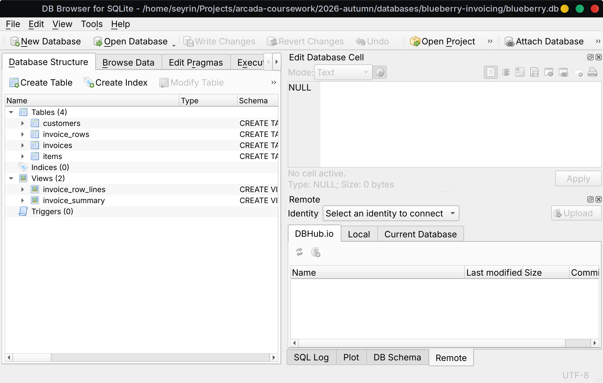
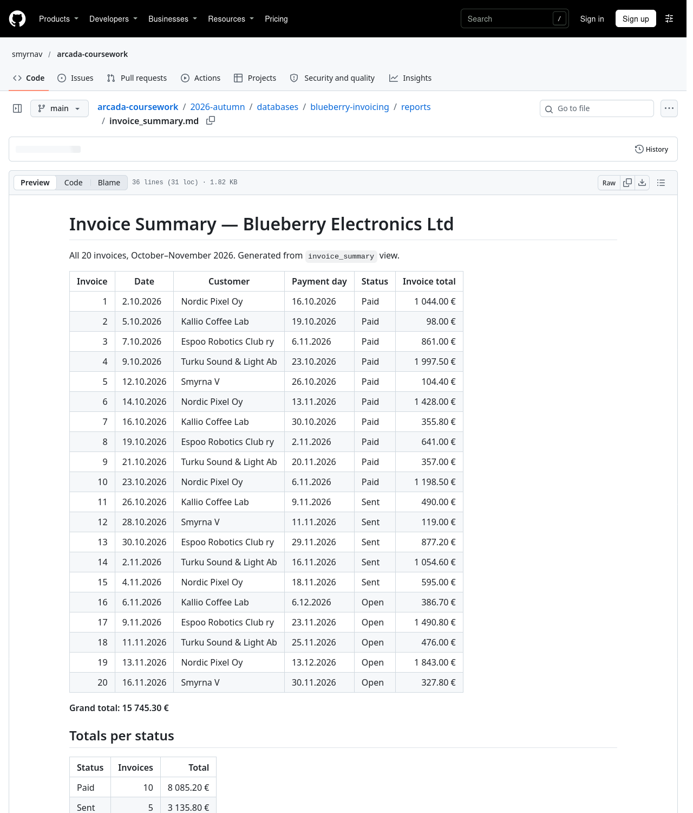
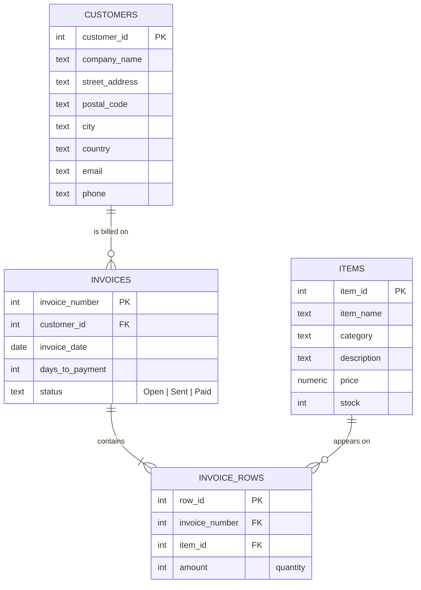

# Blueberry Electronics — Invoicing Database

Databases course final project, Arcada 2026.

The FileMaker assignment (`invoicing_final_assignment_2026.fmp12`) rebuilt as a plain **SQL (SQLite)** database:
the same customers → invoices → invoice rows → items model, filled with the assignment data, plus the
Invoice Summary report and Invoice Form as SQL queries. The data is also exported as CSV, ready for importing
into the FileMaker file.

## Status

| Part | State |
|---|---|
| Data model, data, Invoice Summary and Invoice Form as SQL | **Done**, in this repo |
| [Invoice](reports/Invoice_SmyrnaV_SQL.pdf) and [Invoice Summary](reports/Summary_report_SmyrnaV_SQL.pdf) PDFs generated from SQLite (`make_pdfs.py`) | **Done**, not FileMaker exports |
| CSV exports for FileMaker | **Done**, not yet imported |
| FileMaker work: data entry in the `.fmp12`, Status field on the Invoice Summary layout, Invoice Form layout | **Not done** |
| The two FileMaker PDFs and the edited `.fmp12` | **Not done** |

FileMaker Pro has no Linux version, so the FileMaker part needs a Windows or Mac computer.
Invoices 1–3 here are placeholders: the contents of the three ready-made invoices in the `.fmp12` file could not be read outside FileMaker.

## Screenshots

| Database structure in DB Browser for SQLite | Invoice Summary report |
|---|---|
|  |  |

Also: [Invoice Form, invoice 20](screenshots/invoice_20.png)

**Quick look:** [Invoice Summary report](reports/invoice_summary.md) · [All invoices](reports/all_invoices.md) · [Invoice Form (invoice 20)](reports/invoice_20.md) · [SQL schema](sql/01_schema.sql) · [Queries](sql/03_queries.sql)

## Data model



Calculated values are not stored, they come from views — same idea as FileMaker calculation fields:

| Value | FileMaker field | SQL |
|---|---|---|
| Row total | `Inv row Item Total` | `price * amount` in view `invoice_row_lines` |
| Payment day | `Payment Day` | `DATE(invoice_date, '+N days')` in view `invoice_summary` |
| Invoice total | `Invoice Total` | `SUM(row_total)` in view `invoice_summary` |

## Assignment checklist

| Requirement | Where |
|---|---|
| New customer with my name as company name | `customers` id 1 — [seed](sql/02_seed.sql) |
| 3 new items, all fields filled | `items` 1–3 |
| 20 invoices in total, October + November 2026, ascending dates | `invoices` 1–20 (1–3 = the ready-made ones) |
| Invoices 1–10 Paid, 11–15 Sent, 16–20 Open | `invoices.status` (enforced by `CHECK`) |
| Invoice Summary with Status between Payment Day and Invoice Total, grand total at the bottom | view `invoice_summary` → [report](reports/invoice_summary.md) |
| Invoice Form | query 4 in [queries](sql/03_queries.sql) → [invoice 20](reports/invoice_20.md) |

## Files

```
sql/01_schema.sql     tables, constraints, views
sql/02_seed.sql       the data (customers, items, 20 invoices, invoice rows)
sql/03_queries.sql    reports: summary, grand total, per status, invoice form, top items, overdue
build.py              builds blueberry.db, exports CSVs, writes reports/
make_pdfs.py          generates the Invoice and Invoice Summary PDFs from blueberry.db
blueberry.db          the built SQLite database
exports/*.csv         data for importing into FileMaker (invoices 4–20 only)
reports/*.md          generated reports
screenshots/          screenshots of the database and reports
FILEMAKER_GUIDE.md    step-by-step import into FileMaker
```

## Run it

```sh
python3 build.py                 # rebuilds everything, standard library only
sqlite3 blueberry.db < sql/03_queries.sql
```

Or open `blueberry.db` in [DB Browser for SQLite](https://sqlitebrowser.org/).

## Importing into FileMaker

The CSVs in `exports/` are imported with **File → Import Records**. Step-by-step instructions: [FILEMAKER_GUIDE.md](FILEMAKER_GUIDE.md).
