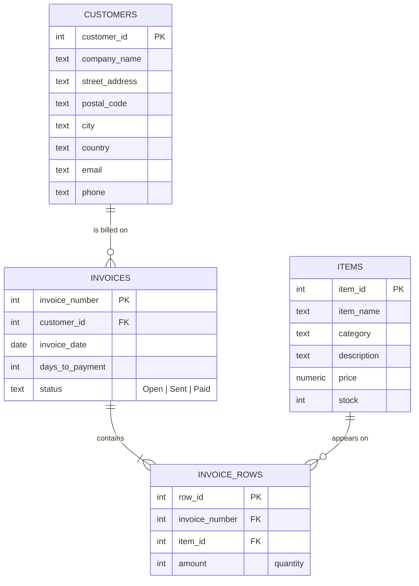

# Blueberry Electronics — Invoicing Database

Databases course final project, Arcada 2026.

The FileMaker assignment (`invoicing_final_assignment_2026.fmp12`) rebuilt as a plain **SQL (SQLite)** database:
the same customers → invoices → invoice rows → items model, filled with the assignment data, plus the
Invoice Summary report and Invoice Form as SQL queries. The data is exported as CSV and imported into the
FileMaker file, where the layouts and PDFs are made.

**Quick look:** [Invoice Summary report](reports/invoice_summary.md) · [Invoice Form (invoice 20)](reports/invoice_20.md) · [SQL schema](sql/01_schema.sql) · [Queries](sql/03_queries.sql)

## Data model



Calculated values are not stored, they come from views — same idea as FileMaker calculation fields:

| Value | FileMaker field | SQL |
|---|---|---|
| Row total | `Inv row Item Total` | `price * amount` in view `invoice_row_lines` |
| Payment day | `Payment Day` | `DATE(invoice_date, '+N days')` in view `invoice_summary` |
| Invoice total | `Invoice Total` | `SUM(row_total)` in view `invoice_summary` |

## Assignment checklist

| Requirement | Where |
|---|---|
| New customer with my name as company name | `customers` id 1 — [seed](sql/02_seed.sql) |
| 3 new items, all fields filled | `items` 1–3 |
| 20 invoices in total, October + November 2026, ascending dates | `invoices` 1–20 (1–3 = the ready-made ones) |
| Invoices 1–10 Paid, 11–15 Sent, 16–20 Open | `invoices.status` (enforced by `CHECK`) |
| Invoice Summary with Status between Payment Day and Invoice Total, grand total at the bottom | view `invoice_summary` → [report](reports/invoice_summary.md) |
| Invoice Form | query 4 in [queries](sql/03_queries.sql) → [invoice 20](reports/invoice_20.md) |

## Files

```
sql/01_schema.sql     tables, constraints, views
sql/02_seed.sql       the data (customers, items, 20 invoices, invoice rows)
sql/03_queries.sql    reports: summary, grand total, per status, invoice form, top items, overdue
build.py              builds blueberry.db, exports CSVs, writes reports/
blueberry.db          the built SQLite database
exports/*.csv         data for importing into FileMaker (invoices 4–20 only)
reports/*.md          generated reports
```

## Run it

```sh
python3 build.py                 # rebuilds everything, standard library only
sqlite3 blueberry.db < sql/03_queries.sql
```

Or open `blueberry.db` in [DB Browser for SQLite](https://sqlitebrowser.org/).

## Importing into FileMaker

In the `.fmp12` file, **File → Import Records → File…**, pick the CSV, then in the field-mapping dialog
match the columns to the FileMaker fields. Import in this order so the IDs line up:

1. `customers.csv` → Customers (or import just row 1, my own customer)
2. `items.csv` → Items
3. `invoices.csv` → Invoices (17 records, numbers 4–20)
4. `invoice_rows.csv` → Invoice rows

Notes:
- Untick **"Perform auto-enter options while importing"** so the IDs from the CSV are kept. If FileMaker
  gives the customer and items different IDs, change `customer_id` / `item_id` in the CSVs to match
  before importing invoices and rows.
- Dates are in `D.M.YYYY` format, which is what FileMaker expects on Finnish/Swedish Windows.
- Don't map calculation fields (row total, payment day, invoice total) — FileMaker computes them.
