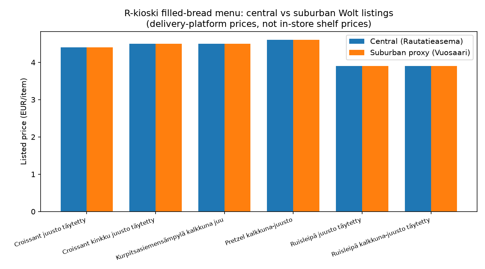

# Introduction to Marketing — Group Work 2026

**Smyrna Volzhevska** (completed individually; teacher-approved individual submission)

## Methodological note (replaces group instructions)

This assignment was completed individually with the teacher's permission. Because no
group fieldwork took place, the physical mystery-shopping elements (store visits, shelf
photographs, in-person customer observation) were **not assessed**. They are replaced by
a digital shelf audit: retailer online catalogues, product listings and delivery-platform
menus for Helsinki, collected 24 November 2026, analysed with Python. Product and menu
photographs are replaced by data tables and charts. Where the template asks for physical
observations, the substitution is stated openly in the relevant section rather than
imitated. The Part C classroom survey is replaced by a reflection on the McKinsey
article, as agreed with the teacher. All data, code and sources:
[github.com/smyrnav/arcada-coursework](https://github.com/smyrnav/arcada-coursework/tree/main/2026-autumn/introduction-to-marketing/private-label-retail-analytics)
(2026-autumn/introduction-to-marketing/private-label-retail-analytics). The assignment
structure follows the course template (Arcada University of Applied Sciences 2026).

# PART A: Retail (Kesko, S-group, Lidl), private labels

## 2.1. Own-brand products in grocery stores within KESKO

Kesko's grocery own-brand architecture is a tiered family built around **Pirkka**:
Pirkka as the mainstream tier (Kesko states the range covers more than 2,800 products),
**Pirkka Parhaat** as the premium tier, and **K-Menu** as the low-price tier aimed at
price-conscious shoppers (Kesko 2026). In our snack sample, Pirkka Original perunalastu
(275 g) was listed at €2.19 (€7.96/kg) — 28.4% cheaper per kg than the Taffel benchmark
in the same K-Ruoka catalogue (K-Ruoka 2026). This is a clear mainstream me-too
position: a direct equivalent of the national brand at a consistently lower unit price,
exactly the "price gapping" discipline described in the McKinsey framework (Begley &
McOuat 2020, p. 7).

## 2.2. Own-brand products in grocery stores within the S-group

S Group runs a **multi-brand portfolio** rather than one family: **Xtra** (value/opening
price point), **Coop** (mainstream) and **Kotimaista** (origin-positioned, Finnish
provenance) (S-kaupat 2026a). All three appear in the same S-kaupat crisp category
alongside national brands. In our sample: Xtra salted crisps €1.71/250 g (€6.84/kg),
Coop salted crisps €2.35/300 g (€7.83/kg), Kotimaista salted crisps €1.99/200 g
(€9.95/kg) — against Taffel at €10.19/kg (S-kaupat 2026b). The portfolio spans three
distinct price tiers inside one product category, which maps onto the "portfolio
management" stage of McKinsey's maturity model: different sub-brands covering different
customer need states (Begley & McOuat 2020, p. 5).

## 2.3. Own-brand products in Lidl's grocery stores

Lidl's model differs structurally: the assortment is dominated by own brands. The
Finnish Competition and Consumer Authority's 2025 research report identified **more than
150 Lidl private-label brands** in its dataset — not one store brand but a large
portfolio of category-specific labels (Kilpailu- ja kuluttajavirasto 2025). In our snack
sample we found **Snack Day** (truffle-flavoured crisps, €2.49/150 g) (Lidl 2026a) and
**Deluxe** (premium-tier crisps, €1.99/150 g) (Lidl 2026b). Because Lidl's shelves carry
few national brands, no matched national-brand price pair could be built for Lidl in
this sample; its private labels largely *are* the assortment, which is itself the
loyalty strategy McKinsey describes for private-label-led retailers (Begley & McOuat
2020, p. 8).

## 2.4. Product categories and product examples

The digital audit covered one category in depth (snacks/crisps) across the three chains,
plus R-kioski convenience foods in Part B; the retailers' own-brand pages show own labels
across well over 15 product categories each (dry foods, dairy, frozen, household
chemicals etc.) (Kesko 2026; S-kaupat 2026a), but only categories with collected data
are claimed here. Product examples from the dataset (online catalogue images exist at
the source URLs; they are not physical store photographs) (K-Ruoka 2026; S-kaupat 2026b;
Lidl 2026a; FeedMyCart 2026):

| Retailer | Product | Category | Price | Unit price |
|---|---|---|---|---|
| Kesko | Pirkka Original perunalastu 275 g | snacks / plain crisps | €2.19 | €7.96/kg |
| Kesko | Pirkka salted snack 175 g | snacks / seasoned snack | €1.99 | €11.37/kg |
| S Group | Xtra suolatut perunalastut 250 g | snacks / plain crisps | €1.71 | €6.84/kg |
| S Group | Coop maalaisperunalastut merisuola 175 g | snacks / country-style crisps | €1.65 | €9.43/kg |
| Lidl | Snack Day tryffelinmakuinen perunalastu 150 g | snacks / flavoured crisps | €2.49 | €16.60/kg |
| Lidl | Snack Day suolatikut 250 g | snacks / salted pretzel sticks | €0.99 (promo) | €3.96/kg |

## 2.5. Shelf positions — digital substitute (100–150 words)

Physical shelf placement was not assessed (see methodological note). The digital
equivalent — catalogue merchandising — was examined instead. In both K-Ruoka and
S-kaupat online category listings, private-label products appear **interleaved with
national brands in the same category grid**, not segregated into a separate "cheap"
section; both catalogues also offer own-brand filter facets, which actively surfaces the
retailers' own labels (K-Ruoka 2026; S-kaupat 2026b). Notably, the national benchmark
(Taffel) carried a Plussa multi-buy promotion in the K-Ruoka listing while the private
labels held plain regular prices — consistent with McKinsey's observation that national
brands defend position through promotions while private labels defend a standing price
gap (Begley & McOuat 2020, p. 7). Whether this digital parity matches physical shelf
placement remains unverified.

## 2.6. Summary of Part A (150–200 words)

Three findings stand out. First, the private-label price gap is real and consistent in
our sample: 23–33% per kg below the Taffel benchmark across both chains that stock one.
Second, the retailers' architectures differ more than expected — Kesko's tiered Pirkka
family, S Group's three separate brands inside a single crisp category, and Lidl's
own-label-dominated assortment are three genuinely different strategies, not cosmetic
variants. What surprised me most was S Group running three own brands at three price
tiers within one low-involvement category; that is portfolio management of the kind
McKinsey assigns to more mature markets, applied to crisps (Begley & McOuat 2020, p. 5). Third, the data also shows
its own limits: Lidl could not be price-benchmarked because it lacks national-brand
comparators, and without store-verified prices the exact Helsinki gaps remain
indicative. What the data cannot establish at all is whether shoppers actually choose
these products — positioning is visible, preference is not. A short physical verification visit would
complement the digital audit well, and the dataset is structured so that store-verified
prices can simply be appended later.

### References (Part A)

- Arcada University of Applied Sciences (2026) *Group work template, Introduction to Marketing 2026* [course assignment template].
- Begley, S. & McOuat, A. (2020) *Turning private labels into powerhouse brands*. McKinsey & Company, October 2020. Available at: [https://www.mckinsey.com/industries/retail/our-insights/turning-private-labels-into-powerhouse-brands](https://www.mckinsey.com/industries/retail/our-insights/turning-private-labels-into-powerhouse-brands) (Accessed: 24 November 2026).
- FeedMyCart (2026) *Lidl Finland — current offers* [offer aggregator]. Available at: [https://feedmycart.nl/fi/countries/finland/lidl/](https://feedmycart.nl/fi/countries/finland/lidl/) (Accessed: 24 November 2026). Promotional price observation dated 23 November 2026.
- Kesko (2026) *K Group's own grocery store brands: Pirkka and K-Menu*. Available at: [https://www.kesko.fi/en/company/brands/own-brands/pirkka-and-k-menu/](https://www.kesko.fi/en/company/brands/own-brands/pirkka-and-k-menu/) (Accessed: 24 November 2026).
- Kilpailu- ja kuluttajavirasto (2025) *Kaupan omat merkit eli private label -tuotteet elintarvikemarkkinoilla*. Tutkimusraportteja 3/2025. Available at: [https://www.kkv.fi/tutkimus-ja-vaikuttaminen/julkaisut/tutkimusraportit/kaupan-omat-merkit-eli-private-label-tuotteet-elintarvikemarkkinoilla-tutkimusraportteja-3-2025/](https://www.kkv.fi/tutkimus-ja-vaikuttaminen/julkaisut/tutkimusraportit/kaupan-omat-merkit-eli-private-label-tuotteet-elintarvikemarkkinoilla-tutkimusraportteja-3-2025/) (Accessed: 24 November 2026).
- K-Ruoka (2026) *Makeiset ja naposteltavat: sipsit ja snacksit* [online product catalogue]. Available at: [https://www.k-ruoka.fi/kauppa/tuotehaku/makeiset-ja-naposteltavat/sipsit-ja-snacksit](https://www.k-ruoka.fi/kauppa/tuotehaku/makeiset-ja-naposteltavat/sipsit-ja-snacksit) (Accessed: 24 November 2026).
- Lidl Suomi (2026a) *Snack Day tryffelinmakuinen perunalastu 150 g* [product page]. Available at: [https://www.lidl.fi/p/snack-day-tryffelinmakuinen-perunalastu/p11139827](https://www.lidl.fi/p/snack-day-tryffelinmakuinen-perunalastu/p11139827) (Accessed: 24 November 2026).
- Lidl Suomi (2026b) *Deluxe perunalastut 150 g* [product page]. Available at: [https://www.lidl.fi/p/deluxe-perunalastut/p11041036](https://www.lidl.fi/p/deluxe-perunalastut/p11041036) (Accessed: 24 November 2026).
- S-kaupat (2026a) *Omat merkit* [own-brand overview]. Available at: [https://www.s-kaupat.fi/sivu/omat-merkit](https://www.s-kaupat.fi/sivu/omat-merkit) (Accessed: 24 November 2026).
- S-kaupat (2026b) *Perunalastut — tuotteet* [online product catalogue]. Available at: [https://www.s-kaupat.fi/tuotteet/snacksit/sipsit/perunalastut](https://www.s-kaupat.fi/tuotteet/snacksit/sipsit/perunalastut) (Accessed: 24 November 2026).

# PART B: R-kioski segmentation and target groups

## 3.1. The R-kioski product range: suburban vs central (100–150 words)

Before checking any data, the reasonable prediction was that a central station kiosk
(Rautatieasema) would emphasise grab-and-go items for people in transit, while a
suburban kiosk would lean toward everyday top-up groceries, lottery and parcel services
for local residents. The digital evidence partly contradicts this: the Wolt menus of the
central Rautatieasema kiosk and the suburban-proxy Vuosaari kiosk list the **same six
filled-bread products at identical prices** (€3.90–4.60) (Wolt 2026a; Wolt 2026b). In the digitally visible
assortment there is no location-based differentiation at all — R-kioski appears to run a
standardised core convenience range. Differences may still exist in the parts of the
assortment that delivery platforms do not show (cigarettes, lottery, services), which
remains a hypothesis, not an observation.

## 3.2. Customer segments (200–300 words)

These are **predicted segments from public information and reasoning, not observed
customers**. Behaviours and needs, central vs suburban:

**Central location (Rautatieasema).** *Commuters and travellers* dominate: the defining
need is speed — a filled croissant or coffee consumed on a train, bought in under two
minutes. Price sensitivity is low relative to time sensitivity; the purchase is
occasion-driven ("I have ten minutes before departure"). A second segment is
*city-centre workers and students* treating the kiosk as a fallback lunch or snack
option. Demand peaks around transport timetables, not mealtimes at home.

**Suburban location (Vuosaari proxy).** *Local residents* on routine errands: the kiosk
is a top-up stop between supermarket visits, and the need mix shifts toward services —
parcels, lottery, tobacco, a forgotten ingredient. *Students and young people* form a
second segment with small-basket, frequent, price-aware snack purchases; for them the
€3.90–4.60 filled breads compete directly with fast food and grocery ready meals, so the
value proposition is convenience per euro, not speed. *Evening and weekend demand*
likely weighs heavier than the commuter rush.

**Shared segment:** convenience-oriented buyers who value immediate consumption over
price in both locations — which is precisely the segment the identical standardised
menu serves. The identical pricing suggests R-kioski optimises for this shared need
state rather than differentiating by location, at least in the delivered range. Testing
these hypotheses would require the observation the template originally asked for:
counting who actually buys what, when, at each location.

## 3.3. Mystery shopping — methodological note (150–200 words)

The original task sends groups to two R-kiosks to observe customers and test the segment
predictions. **This was not done.** No customers were observed, no in-store photographs
were taken, and nothing in this report should be read as fieldwork. The digital
substitute compares the two locations' publicly listed Wolt menus (six filled-bread
products each) and finds them identical in product and price (Wolt 2026a; Wolt 2026b).
That is genuine but narrow
evidence: delivery menus show the deliverable core range, not the full store, the
shelf layout, or who shops there. The segment definitions in 3.2 therefore remain
hypotheses consistent with — but not confirmed by — the available data. If fieldwork
were added later, the first test would be basket observation at both locations across a
weekday: whether central purchases cluster on single grab-and-go items at commute peaks,
and suburban baskets on multi-item top-ups in evenings, as predicted. Until then, this section should be graded as secondary digital
research with clearly labelled hypotheses, not as mystery shopping.

## 3.4.1. R-kioski own-brand products

Public digital evidence on R-kioski's own brands is thin, and this is reported as a data
gap rather than filled with assumptions. In the sampled Wolt menus, the filled breads
(croissants, pretzel, rye breads) are sold under the R-kioski venue without a separate
manufacturer brand shown, which is *consistent with* own-brand production but does not
prove trademark ownership — under the Finnish definition, a private label is determined
by brand ownership/control, not by shelf presence (Kilpailu- ja kuluttajavirasto 2025).
Both sampled locations list the same six items at identical prices, so **no difference
in own-brand count between central and suburban locations was found in the digital
assortment** (Wolt 2026a; Wolt 2026b). Verifying R-kioski's
own-brand range properly would require either in-store checking or official assortment
information that is not publicly indexed.

## 3.4.2. Sandwiches and snacks

The sampled range is six filled breads: cheese and ham-cheese croissants, a turkey-cheese
pumpkin-seed roll, a turkey-cheese pretzel, and cheese or turkey-cheese rye breads —
€3.90–4.60 per item, €24.08–29.93 per kg (Wolt 2026a; Wolt 2026b). Competing brands, packaging and the
availability of unpackaged fresh sandwiches could **not** be verified from public digital
sources and are not assessed. Taste is likewise not assessed (no first-hand tasting was
done for this report). What the data does show: the unit prices are roughly **2.5–3.7×
the per-kg price of supermarket private-label crisps** in Part A — a visible convenience
premium. My own view: that premium is the entire business model in one number. Nobody
pays €4.40 for 147 g of croissant because it wins a taste comparison; they pay for
location, immediacy and not having to plan. The identical central/suburban pricing
supports this — the product being sold is convenience, and convenience costs the same
everywhere.

### References (Part B)

- Kilpailu- ja kuluttajavirasto (2025) *Kaupan omat merkit eli private label -tuotteet elintarvikemarkkinoilla*. Tutkimusraportteja 3/2025. Available at: [https://www.kkv.fi/tutkimus-ja-vaikuttaminen/julkaisut/tutkimusraportit/kaupan-omat-merkit-eli-private-label-tuotteet-elintarvikemarkkinoilla-tutkimusraportteja-3-2025/](https://www.kkv.fi/tutkimus-ja-vaikuttaminen/julkaisut/tutkimusraportit/kaupan-omat-merkit-eli-private-label-tuotteet-elintarvikemarkkinoilla-tutkimusraportteja-3-2025/) (Accessed: 24 November 2026).
- R-kioski (2026a) *Helsinki Rautatieasema Scandic Grand Central* [kiosk information page]. Available at: [https://www.r-kioski.fi/kioskit/helsinki-rautatieasema-scandic-grand-central-4/](https://www.r-kioski.fi/kioskit/helsinki-rautatieasema-scandic-grand-central-4/) (Accessed: 24 November 2026).
- R-kioski (2026b) *Helsinki Vuosaari Kaivonkatsojantie 13* [kiosk information page]. Available at: [https://www.r-kioski.fi/kioskit/helsinki-vuosaari-kaivonkatsojantie-13-3/](https://www.r-kioski.fi/kioskit/helsinki-vuosaari-kaivonkatsojantie-13-3/) (Accessed: 24 November 2026).
- Wolt (2026a) *R-kioski Helsinki Rautatieasema Scandic Grand Central — venue menu* [delivery-platform menu]. Available at: [https://wolt.com/en/fin/helsinki/venue/r-kioski-helsinki-rautatieasema-scandic-grand-central](https://wolt.com/en/fin/helsinki/venue/r-kioski-helsinki-rautatieasema-scandic-grand-central) (Accessed: 24 November 2026).
- Wolt (2026b) *R-kioski Helsinki Vuosaari Kaivonkatsojantie 13 — venue menu* [delivery-platform menu]. Available at: [https://wolt.com/fi/fin/helsinki/venue/r-kioski-helsinki-vuosaari-kaivonkatsojantie-13](https://wolt.com/fi/fin/helsinki/venue/r-kioski-helsinki-vuosaari-kaivonkatsojantie-13) (Accessed: 24 November 2026).

# Part C: Reflection on the McKinsey article (individual substitute for the web survey)

Begley and McOuat (2020) argue that private labels win a crisis easily and keep
customers only with difficulty. COVID-19 handed retailers a wave of trial — nearly 40%
of surveyed US consumers tried new brands, driven first by availability gaps and second
by price (Begley & McOuat 2020, p. 2) — but the authors' sharp point is that trial is
not loyalty. Most private labels exist because a supplier offered cheap capacity, not
because anyone defined what the brand is for (Begley & McOuat 2020, p. 4). Their remedy
is the five-area diagnostic (brand strategy, assortment and pricing, communication and
packaging, design and sourcing, operating model) and the three-stage maturity ladder
from opening-price me-too products to private labels that rival national brands as a
reason to choose the store (Begley & McOuat 2020, p. 5).

Reading this against our Helsinki data made the framework feel concrete. The 23–33%
unit-price gaps we measured are exactly the "price gapping" discipline the article
prescribes (Begley & McOuat 2020, p. 7) — but the article warns that a gap alone keeps
no one. What separates Kesko and S Group from the least mature stage is visible in our
sample: tiered architectures (K-Menu/Pirkka/Pirkka Parhaat; Xtra/Coop/Kotimaista)
(Kesko 2026; S-kaupat 2026a) that segment need states rather than just undercutting
Taffel. Lidl fits the article's most interesting case — the retailer whose private
labels are the assortment and the loyalty engine simultaneously (Begley & McOuat 2020,
p. 8; Kilpailu- ja kuluttajavirasto 2025).

My main criticism is the evidence base: 2020 US pandemic surveys. Availability-driven
switching in a panic-buying market tells us little about Finnish consumers in 2026, and
the authors' own data shows a quarter of switchers bought private label only because the
national brand was missing (Begley & McOuat 2020, p. 3) — conscripts, not converts. The
framework's value is diagnostic, not predictive: it asks the right questions about *why
a private label deserves to exist*, which is also the question this assignment's retail
exercise is really asking.

### References (Part C)

- Begley, S. & McOuat, A. (2020) *Turning private labels into powerhouse brands*. McKinsey & Company, October 2020. Available at: [https://www.mckinsey.com/industries/retail/our-insights/turning-private-labels-into-powerhouse-brands](https://www.mckinsey.com/industries/retail/our-insights/turning-private-labels-into-powerhouse-brands) (Accessed: 24 November 2026). [PDF copy provided via Itslearning by the lecturer.]
- Kesko (2026) *K Group's own grocery store brands: Pirkka and K-Menu*. Available at: [https://www.kesko.fi/en/company/brands/own-brands/pirkka-and-k-menu/](https://www.kesko.fi/en/company/brands/own-brands/pirkka-and-k-menu/) (Accessed: 24 November 2026).
- Kilpailu- ja kuluttajavirasto (2025) *Kaupan omat merkit eli private label -tuotteet elintarvikemarkkinoilla*. Tutkimusraportteja 3/2025. Available at: [https://www.kkv.fi/tutkimus-ja-vaikuttaminen/julkaisut/tutkimusraportit/kaupan-omat-merkit-eli-private-label-tuotteet-elintarvikemarkkinoilla-tutkimusraportteja-3-2025/](https://www.kkv.fi/tutkimus-ja-vaikuttaminen/julkaisut/tutkimusraportit/kaupan-omat-merkit-eli-private-label-tuotteet-elintarvikemarkkinoilla-tutkimusraportteja-3-2025/) (Accessed: 24 November 2026).
- S-kaupat (2026a) *Omat merkit* [own-brand overview]. Available at: [https://www.s-kaupat.fi/sivu/omat-merkit](https://www.s-kaupat.fi/sivu/omat-merkit) (Accessed: 24 November 2026).

# Part D: Reflection on the assignment as a whole

**Segmentation in practice.** Part B showed me that segmentation is easy to hypothesise
and hard to verify. My predicted segments were logically tidy, but the only hard
evidence — identical Wolt menus (Wolt 2026a; Wolt 2026b) — pointed the other way:
R-kioski standardises for the shared convenience need state. That tension between a
neat model and thin evidence was the most instructive moment of the assignment.

**Branding and private labels.** The clearest lesson: a private label is a strategy, not
a discount. Kesko's tiered Pirkka family (Kesko 2026), S Group's three brands inside one
crisp category (S-kaupat 2026a; S-kaupat 2026b), and Lidl's 150+ own labels
(Kilpailu- ja kuluttajavirasto 2025) are three different answers to the same question of
what an own brand is for. The McKinsey maturity model gave me the vocabulary to see them
as stages of ambition rather than interchangeable store brands (Begley & McOuat 2020,
p. 5).

**Packaging, placement, advertising.** Digitally, private labels are no longer hidden:
both big chains give them filter facets and equal grid position with national brands,
while national brands lean on promotions (Taffel's Plussa multi-buy) to defend shelf
value (K-Ruoka 2026; S-kaupat 2026b). Whether physical shelves mirror this digital
parity is precisely what I could not check — a honest gap in a digital method.

**Observation and web-based research.** Doing this digitally taught me the trade-off
directly: catalogue data is exact, timestamped and reproducible, but it is silent about
people. I can state that Xtra is 32.9% cheaper per kg than Taffel (S-kaupat 2026b); I
cannot state that anyone buys it for that reason.

**Most insightful finding.** The R-kioski price identity across locations — convenience
priced as a uniform product — and, methodologically, learning that good research
includes reporting what the method cannot see. If I redid the assignment, I would add one
real shelf visit per chain: exact digital prices plus physical shelf context would
answer both halves of the brief.

*All sources cited in Part D are listed in the reference lists of Parts A–C above; no new sources were used.*

# Part E: Presentation (separate submission)

A narrated presentation (voiceover/video, per the teacher's instruction) is submitted
separately. It presents the research question, the dataset, the price-gap and R-kioski
charts above, the McKinsey interpretation, and the limitations of the digital method.
Note: the teacher's email gives **30 November** as the presentation date while the
template says **2 December** — flagged for confirmation.
