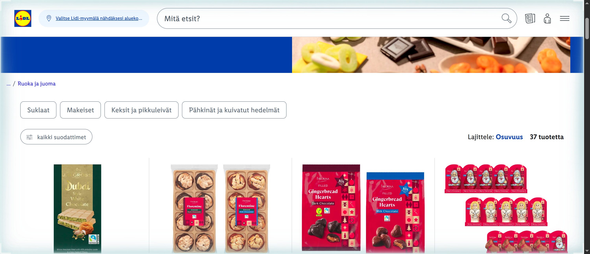
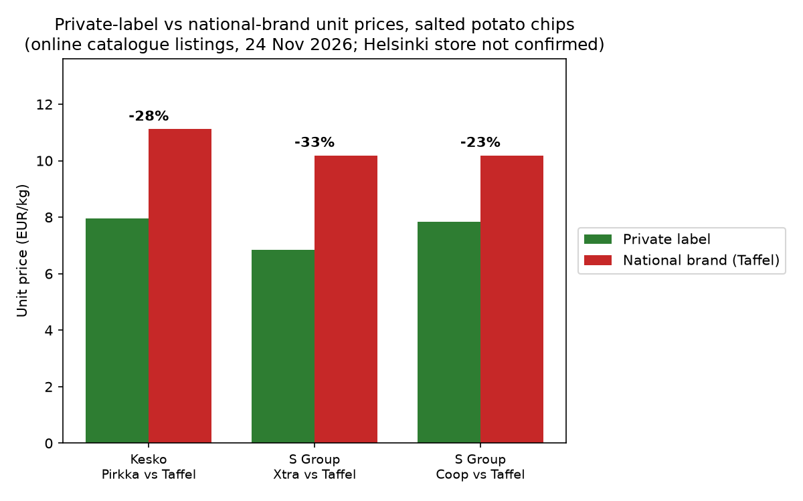
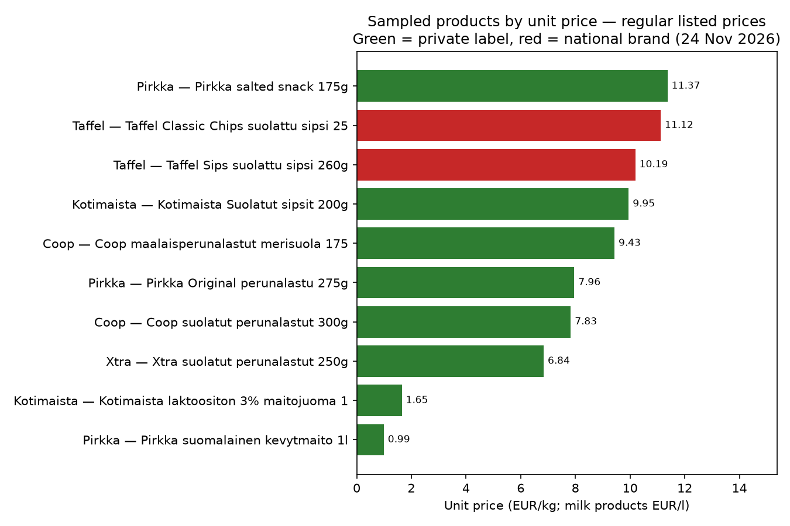
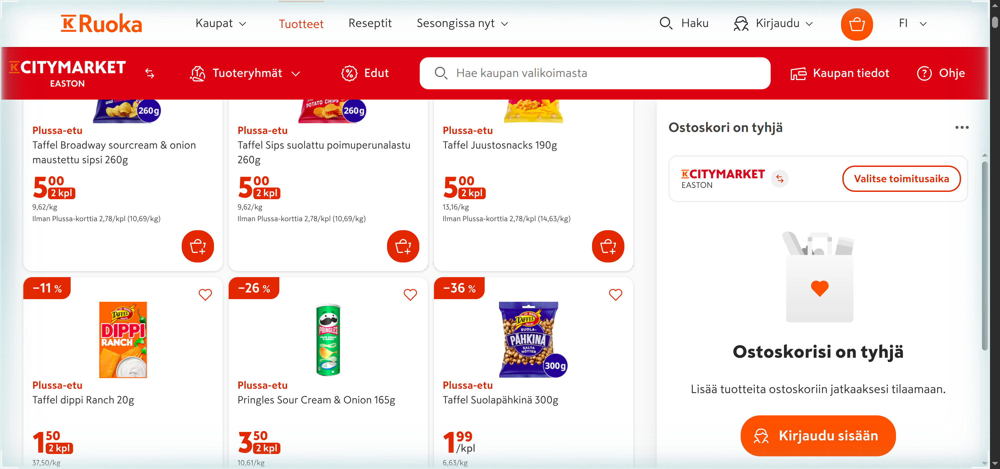
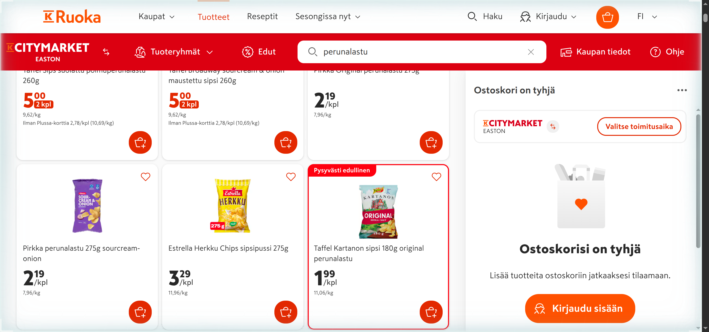
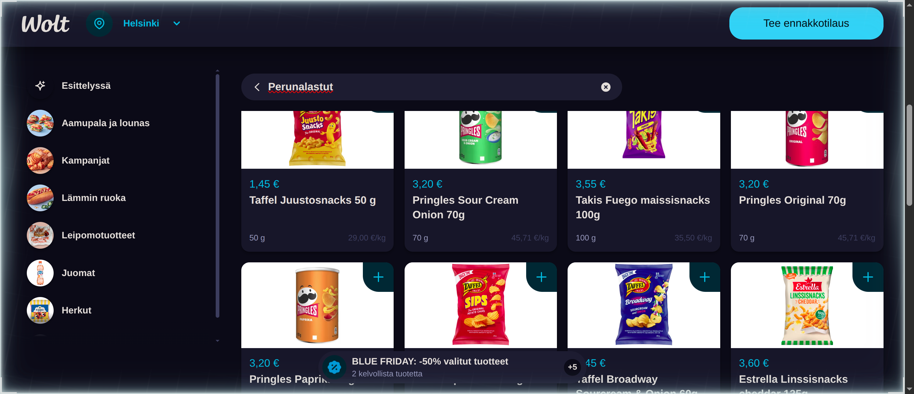
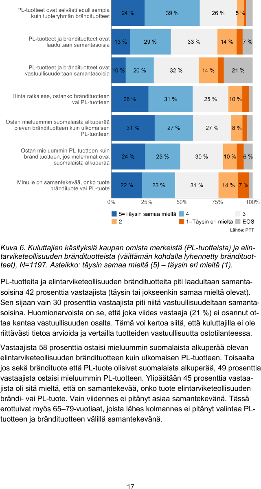
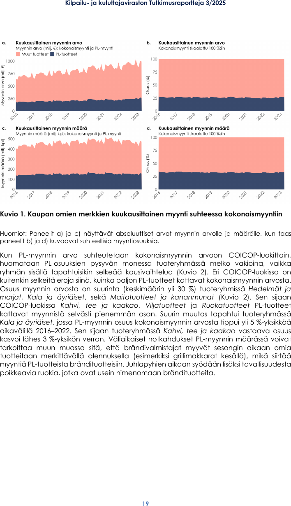

# Introduction to Marketing — Group Work 2026

**Smyrna V.** (individual submission)

**Method.** I completed this assignment individually. Store visits, shelf photographs
and customer observation were not carried out; the research is a digital audit of
retailer online catalogues, product pages and delivery-platform menus, collected
24 November 2026. The teacher suggested individual completion and agreed that a
reflection on the McKinsey article replaces the 25.11 classroom survey (Part C).
Replacing the physical observations with digital research is my own choice, disclosed
here — it was not separately approved. The intended comparison location is Helsinki.
One exception: the earliest K-Ruoka captures had the store set to K-Citymarket Iso
Omena (Espoo); the prices used in the comparison were re-verified on 24 November at
K-Citymarket Easton, Helsinki. All data, code, screenshots and sources:
[github.com/smyrnav/arcada-coursework](https://github.com/smyrnav/arcada-coursework/tree/main/2026-autumn/introduction-to-marketing/private-label-retail-analytics).

# PART A: Retail (Kesko, S-group, Lidl), private labels

## 2.1. Grocery stores within KESKO — what are the own-brand products?

Kesko's grocery own brands form a tiered family around **Pirkka** (Kesko 2023): Pirkka
is the mainstream range (Kesko states it covers more than 2,800 products), **Pirkka
Parhaat** the premium range and **K-Menu** the low-price range. The same three ranges
are listed on K-Ruoka's own-brand pages (K-Ruoka 2026b).

In the sampled snack category, Pirkka Original perunalastu (275 g) was listed at €2.19
(€7.96/kg) at K-Citymarket Easton, Helsinki, on 24.11.2026 (K-Ruoka 2026a). The Taffel
Classic reference listing in the same catalogue was €11.12/kg, so the sampled Pirkka
product was about 28% cheaper per kilogram. One category comparison does not by itself
establish the positioning of the whole Pirkka range. The gap matches what the McKinsey
article recommends: a deliberate, maintained price difference against a national-brand
reference (Begley & McOuat 2020, p. 7).

## 2.2. Grocery stores within the S-group — what are the own-brand products?

S Group uses several separate own brands rather than one family (S-kaupat 2026a):
**Xtra** (affordable everyday products), **Kotimaista** (Finnish food products) and
**Coop** (a Nordic brand built around the quality–price ratio).

In the sampled crisp category (S-kaupat, 24.11.2026): Xtra suolatut perunalastut
€1.71/250 g (€6.84/kg), Coop suolatut perunalastut €2.35/300 g (€7.83/kg) and
Kotimaista suolatut sipsit €1.99/200 g (€9.95/kg), with the Taffel reference listing at
€10.19/kg (S-kaupat 2026b). Three own brands at three price levels inside one category:
Xtra 32.9% and Coop 23.2% below the Taffel reference per kilogram. This resembles what
the article calls portfolio management — several own brands aimed at different
customers rather than one cheap alternative (Begley & McOuat 2020, p. 5).

## 2.3. Lidl's grocery stores — what are the own-brand products?

KKV's research dataset, which covers January 2015 to April 2023, identified more than
150 Lidl own-brand names (Kilpailu- ja kuluttajavirasto 2025). That is a historical
count; it does not show how many own brands Lidl carries in 2026. In the current online
assortment I found **Snack Day** and **Deluxe** snacks — both marked "Erä", meaning
limited batches rather than permanent products, and both product pages have since gone
offline (Lidl 2026a; Lidl 2026b) — plus **Favorina** seasonal sweets in the current
snacks category (Lidl 2026c) and the **Kartanon** and **Koskikylän** ready-meal ranges,
which Lidl presents as own brands built around Finnish origin (Lidl 2026d). Lidl's
public pages do not list current prices for most of these, and my sample has no
national-brand comparator at Lidl, so no price pair was built for it.

## 2.4. In how many product categories did you find the own brands? Product examples

I verified own-brand products in **two broad product categories per retailer**, so the
answer falls in the 0–5 category band. I did not count the full product ranges.

Two examples per chain, from different categories (online catalogue images, not
mystery-shopping photographs):

| Retailer | Product | Category | Price (24.11.2026) |
|---|---|---|---|
| Kesko (K-Citymarket Easton) | Pirkka Original perunalastu 275 g | snacks | €2.19 (€7.96/kg) |
| Kesko (K-Citymarket Easton) | Pirkka suomalainen kevytmaito 1 l | dairy | €0.99 (€0.99/l) |
| S Group (S-kaupat) | Xtra suolatut perunalastut 250 g | snacks | €1.71 (€6.84/kg) |
| S Group (S-kaupat) | Kotimaista laktoositon 3 % maitojuoma 1 l | dairy | €1.65 (€1.65/l) |
| Lidl | Favorina filled gingerbread hearts | snacks/sweets | seasonal listing, no price shown online |
| Lidl | Kartanon ready meals | ready meals | brand page only; no current product listing or price online |

(K-Ruoka 2026a; S-kaupat 2026b; Lidl 2026c; Lidl 2026d.)

## 2.5. Shelf positions: own brands compared to regular brands (100–150 words)

Physical shelf positions were not assessed. The digital substitute is catalogue
merchandising. In the unfiltered S-kaupat crisp listing, Xtra, Coop and Kotimaista
appear in the same product grid as Taffel, Estrella and Pringles (S-kaupat 2026b).
At K-Ruoka (K-Citymarket Easton), the default ordering showed promoted national brands
with Plussa offers first, while own brands appeared further down and through the
own-brand filter (K-Ruoka 2026a; K-Ruoka 2026b). One Taffel multi-buy offer was
visible; a single offer does not show how national brands generally use promotions.
Digital listing order does not prove physical shelf position.

## 2.6. Summarise Part A (150–200 words)

Three findings stand out for me. First, the private-label price gap is consistent in my
sample: 23–33% per kilogram below the Taffel reference in both chains that stock it.
Second, the three chains use clearly different approaches — Kesko's tiered Pirkka
family, S Group's three own brands inside one crisp category, and Lidl's mix of
limited-batch snack labels and origin-focused ready-meal brands. What surprised me most
was finding three S Group own brands at three price levels in something as ordinary as
crisps; the article treats exactly this as a sign of a more developed private-label
market (Begley & McOuat 2020, p. 5). Third, the sample shows its own limits: Lidl could
not be price-compared because I found no national-brand comparator, the Lidl prices I
had were from limited batches or older captures, and one early capture used an Espoo
store before I re-verified prices in Helsinki. My data shows how products are priced
and positioned; it cannot show whether customers choose them.

### References (Part A)

- Arcada University of Applied Sciences (2026) *Group work template, Introduction to Marketing 2026* [course assignment template].
- Begley, S. & McOuat, A. (2020) *Turning private labels into powerhouse brands*. McKinsey & Company, October 2020. Available at: [https://www.mckinsey.com/industries/retail/our-insights/turning-private-labels-into-powerhouse-brands](https://www.mckinsey.com/industries/retail/our-insights/turning-private-labels-into-powerhouse-brands) (Accessed: 24 November 2026).
- Kesko (2023) *K Group's own grocery store brands: Pirkka and K-Menu*. Available at: [https://www.kesko.fi/en/company/brands/own-brands/pirkka-and-k-menu/](https://www.kesko.fi/en/company/brands/own-brands/pirkka-and-k-menu/) (Accessed: 24 November 2026).
- Kilpailu- ja kuluttajavirasto (2025) *Kaupan omat merkit eli private label -tuotteet elintarvikemarkkinoilla*. Tutkimusraportteja 3/2025. Available at: [https://www.kkv.fi/tutkimus-ja-vaikuttaminen/julkaisut/tutkimusraportit/kaupan-omat-merkit-eli-private-label-tuotteet-elintarvikemarkkinoilla-tutkimusraportteja-3-2025/](https://www.kkv.fi/tutkimus-ja-vaikuttaminen/julkaisut/tutkimusraportit/kaupan-omat-merkit-eli-private-label-tuotteet-elintarvikemarkkinoilla-tutkimusraportteja-3-2025/) (Accessed: 24 November 2026). Dataset covers January 2015–April 2023.
- K-Ruoka (2026a) *Tuotehaku: perunalastu, K-Citymarket Helsinki Easton* [online catalogue, selected store]. Available at: [https://www.k-ruoka.fi/kauppa/tuotehaku?haku=perunalastu](https://www.k-ruoka.fi/kauppa/tuotehaku?haku=perunalastu) (Accessed: 24 November 2026).
- K-Ruoka (2026b) *Makeiset ja naposteltavat: sipsit ja snacksit* [online product catalogue]. Available at: [https://www.k-ruoka.fi/kauppa/tuotehaku/makeiset-ja-naposteltavat/sipsit-ja-snacksit](https://www.k-ruoka.fi/kauppa/tuotehaku/makeiset-ja-naposteltavat/sipsit-ja-snacksit) (Accessed: 24 November 2026).
- Lidl (2026a) *Snack Day tryffelinmakuinen perunalastu 150 g* [product page, "Erä" limited batch; offline at access date]. Available at: [https://www.lidl.fi/p/snack-day-tryffelinmakuinen-perunalastu/p11139827](https://www.lidl.fi/p/snack-day-tryffelinmakuinen-perunalastu/p11139827) (Accessed: 24 November 2026).
- Lidl (2026b) *Deluxe perunalastut 150 g* [product page, "Erä" limited batch; offline at access date]. Available at: [https://www.lidl.fi/p/deluxe-perunalastut/p11041036](https://www.lidl.fi/p/deluxe-perunalastut/p11041036) (Accessed: 24 November 2026).
- Lidl (2026c) *Makeiset ja snacksit* [category page]. Available at: [https://www.lidl.fi/h/makeiset-ja-snacksit/h10096205](https://www.lidl.fi/h/makeiset-ja-snacksit/h10096205) (Accessed: 24 November 2026).
- Lidl (2026d) *Kartanon* [own-brand page]. Available at: [https://www.lidl.fi/c/kartanon/s10034513](https://www.lidl.fi/c/kartanon/s10034513) (Accessed: 24 November 2026).
- S-kaupat (2026a) *Omat merkit* [own-brand overview]. Available at: [https://www.s-kaupat.fi/sivu/omat-merkit](https://www.s-kaupat.fi/sivu/omat-merkit) (Accessed: 24 November 2026).
- S-kaupat (2026b) *Perunalastut — tuotteet* [online product catalogue]. Available at: [https://www.s-kaupat.fi/tuotteet/snacksit/sipsit/perunalastut](https://www.s-kaupat.fi/tuotteet/snacksit/sipsit/perunalastut) (Accessed: 24 November 2026).

# PART B: R-kioski segmentation and target groups

## 3.1. The R-kioski product range: suburban vs central (100–150 words)

My prediction before checking was that a central station kiosk (Rautatieasema) would
emphasise grab-and-go products, while a suburban kiosk would lean toward everyday
top-up shopping and services. The digital evidence partly contradicts this: the Wolt
menus of the central Rautatieasema kiosk and the suburban-proxy Vuosaari kiosk list
the same six filled breads at identical prices (Wolt 2026a; Wolt 2026b):

| Product | Weight | Price (both locations) |
|---|---|---|
| Croissant, cheese filling | 147 g | €4.40 |
| Croissant, ham and cheese | 170 g | €4.50 |
| Pumpkin-seed roll, turkey and cheese | 176 g | €4.50 |
| Pretzel, turkey and cheese | 191 g | €4.60 |
| Rye bread, cheese filling | 150 g | €3.90 |
| Rye bread, turkey and cheese | 161 g | €3.90 |

The menus establish the listed delivery assortment only; they do not prove the physical
kiosks carry identical ranges. Vuosaari remains a suburban proxy — I could not verify
the stand-alone format the template describes.

## 3.2. Which customer segments are similar or different? (200–300 words)

These segments are hypotheses from public information and reasoning, not observations.

**Central location (Rautatieasema).** I would expect people in transit — commuters and
travellers buying something immediately before a departure, where speed and location
matter more than price. A second likely group is people working or studying nearby who
use the kiosk as a quick lunch or snack option. Demand probably follows transport
timetables more than home mealtimes.

**Suburban location (Vuosaari proxy).** I would expect local residents on routine
errands: top-up purchases between supermarket visits, plus services such as parcels
and lottery. Because a supermarket is usually nearby, these customers have a cheaper
alternative for the same products, so kiosk purchases there probably depend more on
opening hours and distance than in the city centre.

**Shared segment.** In both locations, the kiosk serves people who want something
immediately and are willing to pay for that. The identical menus and prices suggest
R-kioski standardises its delivered range for this shared need rather than adapting it
by location.

These are predictions. Testing them would require the observation the template
originally asked for: watching who actually buys what, and when, at each location.

## 3.3. Mystery shopping — what was done instead (150–200 words)

No customer observations were made. I did not visit the kiosks, took no photographs,
and nothing in this section is fieldwork. The digital substitute compares the two
locations' publicly listed Wolt menus and finds them identical in product and price
(Wolt 2026a; Wolt 2026b). That is genuine but narrow evidence: delivery menus show the
deliverable core range, not the full store, the shelf layout, or who shops there. The
segments in 3.2 therefore remain hypotheses consistent with — but not confirmed by —
the available data. If fieldwork were added later, the first test would be basket
observation at both locations across a weekday: whether central purchases cluster on
single grab-and-go items at commute peaks, and suburban baskets on multi-item top-ups
in evenings, as predicted. Until then, this section is secondary digital research with
clearly labelled hypotheses, not mystery shopping.

## 3.4.1. R-kioski's own brands: what are they called, in which categories, same number in both locations?

Public digital evidence on R-kioski's own brands is thin, and I report this as a data
gap instead of guessing. In the sampled Wolt menus, the filled breads are sold under
the R-kioski venue with no separate manufacturer brand shown. This is consistent with
own-brand production but does not prove trademark ownership — under the Finnish
definition, a private label is determined by brand ownership or control, not by shelf
presence (Kilpailu- ja kuluttajavirasto 2025). Both locations list the same six items
at identical prices, so I found no difference in own-brand count between the central
and suburban location in the digital assortment (Wolt 2026a; Wolt 2026b).

## 3.4.2. R-kioski sandwiches and snacks: competitors, packaging, pricing, choice — and my own opinion

The sampled range is six filled breads at €3.90–4.60 per item (Wolt 2026a; Wolt 2026b).
Competing brands, packaging and unpackaged fresh sandwiches could not be verified from
public digital sources, and I did not taste the products, so those parts of the
question are unanswered rather than guessed. One same-category comparison is possible:
the kiosk's national-brand crisps cost several times more per kilogram than crisps in
the supermarkets of Part A — for example Pringles 70 g at €3.20 (€45.71/kg) at the
Vuosaari kiosk (Wolt 2026b), against roughly €7–11/kg at K-Ruoka and S-kaupat. My own
view: kiosk prices are not about the product. Customers pay for getting something
immediately, exactly where they already are.

### References (Part B)

- Kilpailu- ja kuluttajavirasto (2025) *Kaupan omat merkit eli private label -tuotteet elintarvikemarkkinoilla*. Tutkimusraportteja 3/2025. Available at: [https://www.kkv.fi/tutkimus-ja-vaikuttaminen/julkaisut/tutkimusraportit/kaupan-omat-merkit-eli-private-label-tuotteet-elintarvikemarkkinoilla-tutkimusraportteja-3-2025/](https://www.kkv.fi/tutkimus-ja-vaikuttaminen/julkaisut/tutkimusraportit/kaupan-omat-merkit-eli-private-label-tuotteet-elintarvikemarkkinoilla-tutkimusraportteja-3-2025/) (Accessed: 24 November 2026).
- R-kioski (2026a) *Helsinki Rautatieasema Scandic Grand Central* [kiosk information page]. Available at: [https://www.r-kioski.fi/kioskit/helsinki-rautatieasema-scandic-grand-central-4/](https://www.r-kioski.fi/kioskit/helsinki-rautatieasema-scandic-grand-central-4/) (Accessed: 24 November 2026).
- R-kioski (2026b) *Helsinki Vuosaari Kaivonkatsojantie 13* [kiosk information page]. Available at: [https://www.r-kioski.fi/kioskit/helsinki-vuosaari-kaivonkatsojantie-13-3/](https://www.r-kioski.fi/kioskit/helsinki-vuosaari-kaivonkatsojantie-13-3/) (Accessed: 24 November 2026).
- Wolt (2026a) *R-kioski Helsinki Rautatieasema Scandic Grand Central — venue menu* [delivery-platform menu]. Available at: [https://wolt.com/en/fin/helsinki/venue/r-kioski-helsinki-rautatieasema-scandic-grand-central](https://wolt.com/en/fin/helsinki/venue/r-kioski-helsinki-rautatieasema-scandic-grand-central) (Accessed: 24 November 2026).
- Wolt (2026b) *R-kioski Helsinki Vuosaari Kaivonkatsojantie 13 — venue menu* [delivery-platform menu]. Available at: [https://wolt.com/fi/fin/helsinki/venue/r-kioski-helsinki-vuosaari-kaivonkatsojantie-13](https://wolt.com/fi/fin/helsinki/venue/r-kioski-helsinki-vuosaari-kaivonkatsojantie-13) (Accessed: 24 November 2026).

# Part C: Reflection on the McKinsey article (individual substitute for the web survey)

What I found most interesting in this article was the difference between getting
someone to try a product and giving them a reason to buy it again. During COVID-19,
many consumers switched brands because their usual products were unavailable or because
cheaper alternatives made more sense financially (Begley & McOuat 2020, pp. 2–3). That
does not necessarily mean they preferred the new products. It made me think about how
easily we can confuse a purchase with a preference.

The authors argue that retailers should think more carefully about what their private
labels actually offer. A lower price is one reason to choose a product, but it is not
much of an identity. I found their discussion of different price tiers and customer
needs particularly relevant when looking at Kesko and S Group. Both have several
private-label brands rather than relying on one brand to serve everyone (Kesko 2023;
S-kaupat 2026a).

My own product comparisons also showed lower unit prices for the sampled private-label
crisps (K-Ruoka 2026a; S-kaupat 2026b). But I cannot tell from those figures whether
customers buy them because they like the products, because they are cheaper, or simply
because they are available. That is an important limitation of the research.

Although the article is based on the US market during the pandemic, I still find its
central question relevant: what makes someone choose a retailer's own brand when
cheaper prices are no longer the main reason? Recent Finnish research asks the same
question: in a 2025 survey of 1,197 consumers aged 18–79, price was still the main
grocery purchase criterion, 63% considered private labels more affordable than
manufacturer brands, and 42% saw no quality difference (PTT 2025). Yet private labels
held only about a quarter of Finnish grocery sales value — and about a third of sales
volume — in 2016–2023 (Kilpailu- ja kuluttajavirasto 2025). I think that is a more
interesting way to look at private labels than simply comparing which products cost
less.

### References (Part C)

- Begley, S. & McOuat, A. (2020) *Turning private labels into powerhouse brands*. McKinsey & Company, October 2020. Available at: [https://www.mckinsey.com/industries/retail/our-insights/turning-private-labels-into-powerhouse-brands](https://www.mckinsey.com/industries/retail/our-insights/turning-private-labels-into-powerhouse-brands) (Accessed: 24 November 2026). [PDF copy provided via Itslearning by the lecturer.]
- Kesko (2023) *K Group's own grocery store brands: Pirkka and K-Menu*. Available at: [https://www.kesko.fi/en/company/brands/own-brands/pirkka-and-k-menu/](https://www.kesko.fi/en/company/brands/own-brands/pirkka-and-k-menu/) (Accessed: 24 November 2026).
- Kilpailu- ja kuluttajavirasto (2025) *Kaupan omat merkit eli private label -tuotteet elintarvikemarkkinoilla*. Tutkimusraportteja 3/2025. Available at: [https://www.kkv.fi/tutkimus-ja-vaikuttaminen/julkaisut/tutkimusraportit/kaupan-omat-merkit-eli-private-label-tuotteet-elintarvikemarkkinoilla-tutkimusraportteja-3-2025/](https://www.kkv.fi/tutkimus-ja-vaikuttaminen/julkaisut/tutkimusraportit/kaupan-omat-merkit-eli-private-label-tuotteet-elintarvikemarkkinoilla-tutkimusraportteja-3-2025/) (Accessed: 24 November 2026).
- PTT (2025) *Ruuan hinta ratkaisee – kuluttajien näkökulmia ruuan kulutukseen ja ruokamarkkinoihin*. PTT Raportteja. Available at: [https://www.ptt.fi/julkaisut/ruuan-hinta-ratkaisee-kuluttajien-nakokulmia-ruuan-kulutukseen-ja-ruokamarkkinoihin/](https://www.ptt.fi/julkaisut/ruuan-hinta-ratkaisee-kuluttajien-nakokulmia-ruuan-kulutukseen-ja-ruokamarkkinoihin/) (Accessed: 24 November 2026). Consumer survey (n = 1,197, aged 18–79), autumn 2025.
- S-kaupat (2026a) *Omat merkit* [own-brand overview]. Available at: [https://www.s-kaupat.fi/sivu/omat-merkit](https://www.s-kaupat.fi/sivu/omat-merkit) (Accessed: 24 November 2026).

*Dataset sources cited in this part (K-Ruoka 2026a; S-kaupat 2026b) are listed in References (Part A).*

# Part D: Reflection on the assignment as a whole

**Segmentation in practice?** Segmentation is easy to hypothesise and hard to verify.
My predicted central and suburban segments were logically tidy, but the only hard
evidence — identical Wolt menus and prices (Wolt 2026a; Wolt 2026b) — pointed the other
way: R-kioski standardises its delivered range for the same convenience needs in both
locations.

**Branding, co-branding, private/white labels?** The three chains run visibly different
private-label set-ups: Kesko's tiered Pirkka family (Kesko 2023), S Group's three own
brands in one crisp category (S-kaupat 2026b), and Lidl's mix of limited-batch snack
labels and origin-focused ready-meal brands (Lidl 2026c; Lidl 2026d). The McKinsey
maturity model helped me see these as different levels of ambition (Begley & McOuat
2020, p. 5). I did not find clear co-branding in my sample; the closest pattern is
retailers placing own brands and national brands in the same category grid.

**Packaging, shelf placement, advertising in store?** Digitally, private labels are not
hidden: both big chains offer own-brand filters, and S-kaupat lists own brands in the
same grid as national brands. At K-Ruoka, promoted national brands led the default
ordering (K-Ruoka 2026a). Packaging itself I could only see as online product images,
and physical placement I could not check at all.

**Mystery shopping, observation, web surveys?** Working digitally taught me the
trade-off directly: catalogue data is exact, timestamped and reproducible, but silent
about people. I can state that Xtra is 32.9% cheaper per kilogram than the Taffel
reference (S-kaupat 2026b); I cannot state that anyone buys it for that reason.

**Most interesting or insightful?** The identical R-kioski menus and prices across
locations, and learning that a method's limits belong in the report. If I redid the
assignment, I would add one real shelf visit per chain: exact digital prices plus
physical shelf context would answer both halves of the brief.

*All sources cited in Part D are listed in the reference lists of Parts A–C above; no new sources were used.*

# Part E: Presentation (separate submission)

A narrated presentation (voiceover/video, per the teacher's instruction) is submitted
separately. It presents the research question, the dataset, the price-gap and R-kioski
findings, the McKinsey interpretation, and the limitations of the digital method.
