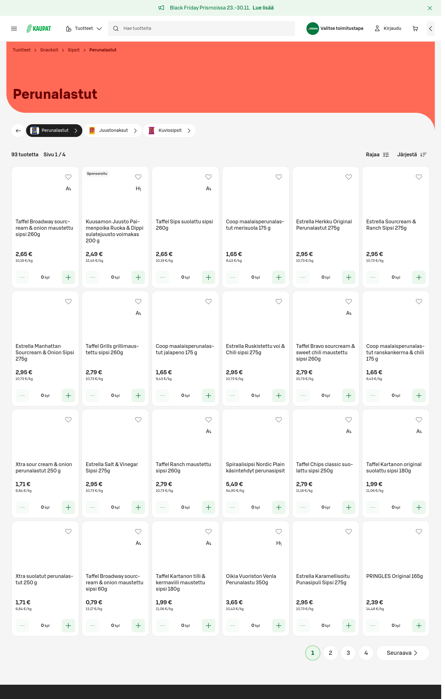
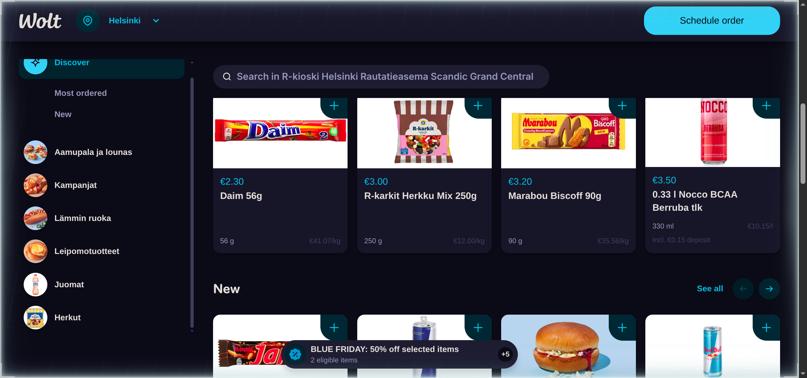
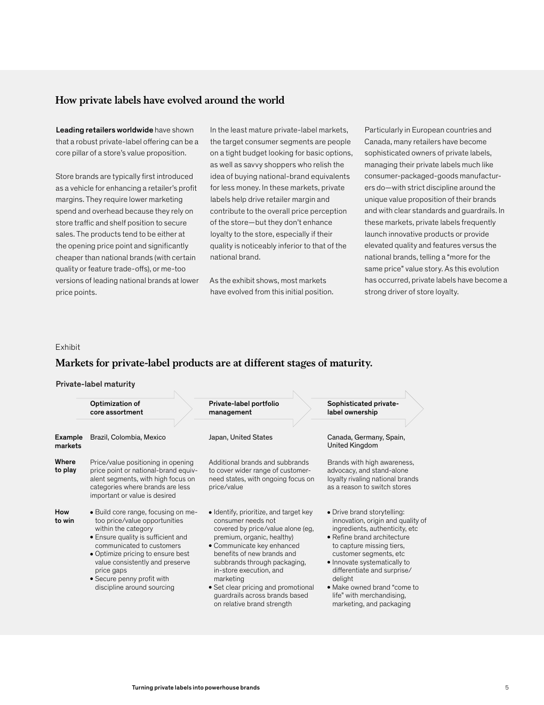

# Introduction to Marketing — Group Work 2026

**Smyrna V.** (individual submission, agreed with the teacher)

**Method.** I completed the research digitally instead of physical mystery shopping:
retailer online catalogues, product pages and delivery-platform menus for Helsinki,
collected 24 November 2026. Store visits, shelf photographs and customer observation
were not carried out, and nothing in this report claims otherwise. Part C is the agreed
article reflection instead of the 25.11 classroom survey. Data, code and sources:
[github.com/smyrnav/arcada-coursework](https://github.com/smyrnav/arcada-coursework/tree/main/2026-autumn/introduction-to-marketing/private-label-retail-analytics).
The report structure follows the course template (Arcada University of Applied Sciences 2026).

# PART A: Retail (Kesko, S-group, Lidl), private labels

## 2.1. What are the own-brand (private-label) products in Kesko's grocery stores?

Kesko organises its grocery own brands as a tiered family around **Pirkka** (Kesko 2026):

| Brand | Positioning | Example from our sample |
|---|---|---|
| Pirkka | Mainstream; Kesko states the range covers 2,800+ products | Pirkka Original perunalastu 275 g — €2.19 (€7.96/kg) |
| Pirkka Parhaat | Premium tier | — |
| K-Menu | Low-price tier | — |

In the K-Ruoka catalogue, the Pirkka crisps cost 28.4% less per kg than the Taffel
benchmark listed in the same category (K-Ruoka 2026). Pirkka is positioned as a
straightforward cheaper equivalent of the national brand. The McKinsey article
recommends exactly this kind of deliberate price gap (Begley & McOuat 2020, p. 7).

## 2.2. What are the own-brand products in S Group's grocery stores?

S Group uses several separate own brands rather than one family (S-kaupat 2026a):

| Brand | Positioning | Example from our sample (S-kaupat 2026b) |
|---|---|---|
| Xtra | Lowest price | Xtra suolatut perunalastut 250 g — €1.71 (€6.84/kg) |
| Coop | Mainstream | Coop suolatut perunalastut 300 g — €2.35 (€7.83/kg) |
| Kotimaista | Finnish origin | Kotimaista suolatut sipsit 200 g — €1.99 (€9.95/kg) |

All three appear in the same S-kaupat crisp category next to national brands, against
Taffel at €10.19/kg (S-kaupat 2026b). Three own brands at three price levels inside one
crisp category looks like what the article calls portfolio management — several own
brands aimed at different customers rather than one cheap alternative (Begley & McOuat
2020, p. 5).

## 2.3. What are the own-brand products in Lidl's grocery stores?

Lidl's own brands dominate its assortment. The Finnish Competition and Consumer
Authority identified **more than 150 Lidl private-label brands** in its 2025 research
dataset — many category-specific labels rather than a single store brand
(Kilpailu- ja kuluttajavirasto 2025).

In our snack sample we found **Snack Day** (truffle-flavoured crisps, €2.49/150 g)
(Lidl 2026a) and **Deluxe** (premium-tier crisps, €1.99/150 g) (Lidl 2026b). Both Lidl
product pages were older captures, so these prices are indicative only. Our sample
contains no national-brand comparator at Lidl, so no price pair could be built for it.
Lidl's own brands largely *are* the assortment; the article notes that retailers built
this way can win loyalty almost entirely through their private labels (Begley & McOuat
2020, p. 8).

## 2.4. In how many product categories did you find the own brands in each store type? Product examples?

Our digital sample verified own brands in **one product category — snacks — at all
three retailers**. We did not examine the full product ranges, so the total number of
categories cannot be established from this data. The retailers' own-brand pages indicate
much wider ranges (Kesko 2026; S-kaupat 2026a).

Two example products per chain, from different snack subcategories:

| Retailer | Product | Subcategory | Price | Unit price |
|---|---|---|---|---|
| Kesko | Pirkka Original perunalastu 275 g | plain crisps | €2.19 | €7.96/kg |
| Kesko | Pirkka salted snack 175 g | seasoned snack | €1.99 | €11.37/kg |
| S Group | Xtra suolatut perunalastut 250 g | plain crisps | €1.71 | €6.84/kg |
| S Group | Coop maalaisperunalastut merisuola 175 g | country-style crisps | €1.65 | €9.43/kg |
| Lidl | Snack Day tryffelinmakuinen perunalastu 150 g | flavoured crisps | €2.49 | €16.60/kg |
| Lidl | Snack Day suolatikut 250 g | salted pretzel sticks | €0.99 (promo) | €3.96/kg |

(K-Ruoka 2026; S-kaupat 2026b; Lidl 2026a; FeedMyCart 2026. Catalogue images exist at
the source URLs; they are not physical store photographs.)

## 2.5. Where are own brands positioned compared to regular brands? (100–150 words)

Physical shelf placement was not assessed. The digital equivalent — catalogue
merchandising — shows this: in both K-Ruoka and S-kaupat online category listings,
private-label products appear **interleaved with national brands in the same category
grid**, not separated into a "cheap" section. Both catalogues also offer own-brand
filter options, which makes the own brands easy to find (K-Ruoka 2026; S-kaupat 2026b).
One detail stands out: the national benchmark (Taffel) carried a Plussa multi-buy
promotion in the K-Ruoka listing, while the private labels held plain regular prices.
This matches the article's observation that national brands rely on promotions while
private labels hold a standing price gap (Begley & McOuat 2020, p. 7). Whether this
digital parity matches physical shelf placement remains unverified.

## 2.6. Summary of Part A: what surprised us? (150–200 words)

Three findings stand out. First, the private-label price gap is consistent in our
sample: 23–33% per kg below the Taffel benchmark in both chains that stock it. Second,
the three chains clearly use different approaches — Kesko's tiered Pirkka family,
S Group's three separate own brands inside one crisp category, and Lidl's
own-label-dominated assortment are genuinely different strategies, not cosmetic
variants. What surprised me most was finding that kind of brand-portfolio thinking in
something as ordinary as crisps; the article treats exactly this as a sign of a more
developed private-label market (Begley & McOuat 2020, p. 5). Third, the data shows its
own limits: Lidl could not be price-benchmarked because our sample has no
national-brand comparator for it, and without store-verified prices the exact Helsinki
gaps remain indicative. The data cannot show whether shoppers actually choose these
products — positioning is visible, preference is not. A short physical verification
visit would complement the digital audit well, and the dataset is structured so that
store-verified prices can simply be appended later.

### References (Part A)

- Arcada University of Applied Sciences (2026) *Group work template, Introduction to Marketing 2026* [course assignment template].
- Begley, S. & McOuat, A. (2020) *Turning private labels into powerhouse brands*. McKinsey & Company, October 2020. Available at: [https://www.mckinsey.com/industries/retail/our-insights/turning-private-labels-into-powerhouse-brands](https://www.mckinsey.com/industries/retail/our-insights/turning-private-labels-into-powerhouse-brands) (Accessed: 24 November 2026).
- FeedMyCart (2026) *Lidl Finland — current offers* [offer aggregator]. Available at: [https://feedmycart.nl/fi/countries/finland/lidl/](https://feedmycart.nl/fi/countries/finland/lidl/) (Accessed: 24 November 2026). Promotional price observation dated 23 November 2026.
- Kesko (2026) *K Group's own grocery store brands: Pirkka and K-Menu*. Available at: [https://www.kesko.fi/en/company/brands/own-brands/pirkka-and-k-menu/](https://www.kesko.fi/en/company/brands/own-brands/pirkka-and-k-menu/) (Accessed: 24 November 2026).
- Kilpailu- ja kuluttajavirasto (2025) *Kaupan omat merkit eli private label -tuotteet elintarvikemarkkinoilla*. Tutkimusraportteja 3/2025. Available at: [https://www.kkv.fi/tutkimus-ja-vaikuttaminen/julkaisut/tutkimusraportit/kaupan-omat-merkit-eli-private-label-tuotteet-elintarvikemarkkinoilla-tutkimusraportteja-3-2025/](https://www.kkv.fi/tutkimus-ja-vaikuttaminen/julkaisut/tutkimusraportit/kaupan-omat-merkit-eli-private-label-tuotteet-elintarvikemarkkinoilla-tutkimusraportteja-3-2025/) (Accessed: 24 November 2026).
- K-Ruoka (2026) *Makeiset ja naposteltavat: sipsit ja snacksit* [online product catalogue]. Available at: [https://www.k-ruoka.fi/kauppa/tuotehaku/makeiset-ja-naposteltavat/sipsit-ja-snacksit](https://www.k-ruoka.fi/kauppa/tuotehaku/makeiset-ja-naposteltavat/sipsit-ja-snacksit) (Accessed: 24 November 2026).
- Lidl (2026a) *Snack Day tryffelinmakuinen perunalastu 150 g* [product page]. Available at: [https://www.lidl.fi/p/snack-day-tryffelinmakuinen-perunalastu/p11139827](https://www.lidl.fi/p/snack-day-tryffelinmakuinen-perunalastu/p11139827) (Accessed: 24 November 2026).
- Lidl (2026b) *Deluxe perunalastut 150 g* [product page]. Available at: [https://www.lidl.fi/p/deluxe-perunalastut/p11041036](https://www.lidl.fi/p/deluxe-perunalastut/p11041036) (Accessed: 24 November 2026).
- S-kaupat (2026a) *Omat merkit* [own-brand overview]. Available at: [https://www.s-kaupat.fi/sivu/omat-merkit](https://www.s-kaupat.fi/sivu/omat-merkit) (Accessed: 24 November 2026).
- S-kaupat (2026b) *Perunalastut — tuotteet* [online product catalogue]. Available at: [https://www.s-kaupat.fi/tuotteet/snacksit/sipsit/perunalastut](https://www.s-kaupat.fi/tuotteet/snacksit/sipsit/perunalastut) (Accessed: 24 November 2026).

# PART B: R-kioski segmentation and target groups

## 3.1. Is the product range the same or different in a suburban and a central R-kioski? (100–150 words)

Before checking any data, my prediction was that a central station kiosk
(Rautatieasema) would emphasise grab-and-go items for people in transit, while a
suburban kiosk would lean toward everyday top-up groceries, lottery and parcel services
for local residents. The digital evidence partly contradicts this: the Wolt menus of
the central Rautatieasema kiosk and the suburban-proxy Vuosaari kiosk list the **same
six filled-bread products at identical prices** (€3.90–4.60) (Wolt 2026a; Wolt 2026b).
In the digitally visible assortment there is no location-based difference at all —
R-kioski appears to run a standardised core convenience range. Differences may still
exist in what delivery platforms do not show (cigarettes, lottery, services); that
remains a hypothesis, not an observation.

## 3.2. Which customer segments are similar or different for suburban and central R-kiosks? (200–300 words)

These are **predicted segments from public information and reasoning, not observed
customers**.

**Central location (Rautatieasema).** *Commuters and travellers* dominate: the defining
need is speed — a filled croissant or coffee consumed on a train, bought in under two
minutes. Price sensitivity is low relative to time sensitivity; the purchase is
occasion-driven ("I have ten minutes before departure"). A second segment is
*city-centre workers and students* treating the kiosk as a fallback lunch or snack
option. Demand peaks around transport timetables, not mealtimes at home.

**Suburban location (Vuosaari proxy).** *Local residents* on routine errands: the kiosk
is a top-up stop between supermarket visits, and the need mix shifts toward services —
parcels, lottery, tobacco, a forgotten ingredient. *Students and young people* form a
second segment with small-basket, frequent, price-aware snack purchases; for them the
€3.90–4.60 filled breads compete directly with fast food and grocery ready meals, so
the value proposition is convenience per euro, not speed. *Evening and weekend demand*
likely weighs heavier than the commuter rush.

**Shared segment:** convenience-oriented buyers who value immediate consumption over
price in both locations — which is precisely the segment the identical standardised
menu serves. The identical pricing suggests R-kioski optimises for this shared need
rather than differentiating by location, at least in the delivered range. Testing
these hypotheses would require the observation the template originally asked for:
counting who actually buys what, when, at each location.

## 3.3. Mystery shopping: do the observations match the predicted segments? (150–200 words)

**No customer observations were made.** No kiosks were visited, no photographs were
taken, and nothing in this section is fieldwork. The digital substitute compares the
two locations' publicly listed Wolt menus (six filled-bread products each) and finds
them identical in product and price (Wolt 2026a; Wolt 2026b). That is genuine but
narrow evidence: delivery menus show the deliverable core range, not the full store,
the shelf layout, or who shops there. The segment definitions in 3.2 therefore remain
hypotheses consistent with — but not confirmed by — the available data. If fieldwork
were added later, the first test would be basket observation at both locations across a
weekday: whether central purchases cluster on single grab-and-go items at commute
peaks, and suburban baskets on multi-item top-ups in evenings, as predicted. Until
then, this section is secondary digital research with clearly labelled
hypotheses, not mystery shopping. The limitation is disclosed here rather than
hidden behind borrowed observations.

## 3.4.1. What are R-kioski's own-brand products, in which categories, and do both locations have the same number?

Public digital evidence on R-kioski's own brands is thin. I report this as a data gap
instead of guessing. In the sampled Wolt menus, the filled breads (croissants, pretzel,
rye breads) are sold under the R-kioski venue without a separate manufacturer brand
shown. This is *consistent with* own-brand production but does not prove trademark
ownership — under the Finnish definition, a private label is determined by brand
ownership/control, not by shelf presence (Kilpailu- ja kuluttajavirasto 2025). Both
sampled locations list the same six items at identical prices, so **no difference in
own-brand count between the central and suburban location was found in the digital
assortment** (Wolt 2026a; Wolt 2026b). Verifying R-kioski's own-brand range properly
would require in-store checking or official assortment information that is not publicly
indexed.

## 3.4.2. Do you find R-kioski-brand sandwiches and similar snacks? Competitors, packaging, pricing, choice — and your own opinion?

The sampled range is six filled breads: cheese and ham-cheese croissants, a
turkey-cheese pumpkin-seed roll, a turkey-cheese pretzel, and cheese or turkey-cheese
rye breads — €3.90–4.60 per item, €24.08–29.93 per kg (Wolt 2026a; Wolt 2026b).
Competing brands, packaging and the availability of unpackaged fresh sandwiches could
not be verified from public digital sources and are not assessed. Taste is likewise not
assessed; I did not taste the products for this report. What the data does show: at
€24–30 per kg, these items cost several times the per-kg price of the supermarket
private-label crisps in Part A (€6.84–9.95/kg) — a visible convenience premium. My own
view: that premium is the entire business model in one number. Nobody pays €4.40 for
147 g of croissant because it wins a taste comparison; they pay for location, immediacy
and not having to plan. The identical central/suburban pricing supports this — the
product being sold is convenience, and convenience costs the same everywhere.

### References (Part B)

- Kilpailu- ja kuluttajavirasto (2025) *Kaupan omat merkit eli private label -tuotteet elintarvikemarkkinoilla*. Tutkimusraportteja 3/2025. Available at: [https://www.kkv.fi/tutkimus-ja-vaikuttaminen/julkaisut/tutkimusraportit/kaupan-omat-merkit-eli-private-label-tuotteet-elintarvikemarkkinoilla-tutkimusraportteja-3-2025/](https://www.kkv.fi/tutkimus-ja-vaikuttaminen/julkaisut/tutkimusraportit/kaupan-omat-merkit-eli-private-label-tuotteet-elintarvikemarkkinoilla-tutkimusraportteja-3-2025/) (Accessed: 24 November 2026).
- R-kioski (2026a) *Helsinki Rautatieasema Scandic Grand Central* [kiosk information page]. Available at: [https://www.r-kioski.fi/kioskit/helsinki-rautatieasema-scandic-grand-central-4/](https://www.r-kioski.fi/kioskit/helsinki-rautatieasema-scandic-grand-central-4/) (Accessed: 24 November 2026).
- R-kioski (2026b) *Helsinki Vuosaari Kaivonkatsojantie 13* [kiosk information page]. Available at: [https://www.r-kioski.fi/kioskit/helsinki-vuosaari-kaivonkatsojantie-13-3/](https://www.r-kioski.fi/kioskit/helsinki-vuosaari-kaivonkatsojantie-13-3/) (Accessed: 24 November 2026).
- Wolt (2026a) *R-kioski Helsinki Rautatieasema Scandic Grand Central — venue menu* [delivery-platform menu]. Available at: [https://wolt.com/en/fin/helsinki/venue/r-kioski-helsinki-rautatieasema-scandic-grand-central](https://wolt.com/en/fin/helsinki/venue/r-kioski-helsinki-rautatieasema-scandic-grand-central) (Accessed: 24 November 2026).
- Wolt (2026b) *R-kioski Helsinki Vuosaari Kaivonkatsojantie 13 — venue menu* [delivery-platform menu]. Available at: [https://wolt.com/fi/fin/helsinki/venue/r-kioski-helsinki-vuosaari-kaivonkatsojantie-13](https://wolt.com/fi/fin/helsinki/venue/r-kioski-helsinki-vuosaari-kaivonkatsojantie-13) (Accessed: 24 November 2026).

# Part C: Reflection on the McKinsey article (individual substitute for the web survey)

What I found most interesting in this article was the difference between getting
someone to try a product and giving them a reason to buy it again. During COVID-19,
many consumers switched brands because their usual products were unavailable or because
cheaper alternatives made more sense financially (Begley & McOuat 2020, pp. 2–3). That
does not necessarily mean they preferred the new products. It made me think about how
easily we can confuse a purchase with a preference.

The authors argue that retailers should think more carefully about what their private
labels actually offer. A lower price is one reason to choose a product, but it is not
much of an identity. I found their discussion of different price tiers and customer
needs particularly relevant when looking at Kesko and S Group. Both have several
private-label brands rather than relying on one brand to serve everyone (Kesko 2026;
S-kaupat 2026a).

Our own product comparisons also showed lower unit prices for the sampled private-label
crisps (K-Ruoka 2026; S-kaupat 2026b). But I cannot tell from those figures whether
customers buy them because they like the products, because they are cheaper, or simply
because they are available. That is an important limitation of our research.

Although the article is based on the US market during the pandemic, I still find its
central question relevant: what makes someone choose a retailer's own brand when
cheaper prices are no longer the main reason? Recent Finnish research asks the same
question: in a 2025 survey of 1,197 consumers, price was still the main grocery
purchase criterion, 63% considered private labels clearly cheaper, and 42% saw no
quality difference compared with manufacturer brands (PTT 2025). Yet private labels
held only about a quarter of Finnish grocery sales value in 2016–2023
(Kilpailu- ja kuluttajavirasto 2025). I think that is a
more interesting way to look at private labels than simply comparing which products
cost less.

### References (Part C)

- Begley, S. & McOuat, A. (2020) *Turning private labels into powerhouse brands*. McKinsey & Company, October 2020. Available at: [https://www.mckinsey.com/industries/retail/our-insights/turning-private-labels-into-powerhouse-brands](https://www.mckinsey.com/industries/retail/our-insights/turning-private-labels-into-powerhouse-brands) (Accessed: 24 November 2026). [PDF copy provided via Itslearning by the lecturer.]
- Kesko (2026) *K Group's own grocery store brands: Pirkka and K-Menu*. Available at: [https://www.kesko.fi/en/company/brands/own-brands/pirkka-and-k-menu/](https://www.kesko.fi/en/company/brands/own-brands/pirkka-and-k-menu/) (Accessed: 24 November 2026).
- Kilpailu- ja kuluttajavirasto (2025) *Kaupan omat merkit eli private label -tuotteet elintarvikemarkkinoilla*. Tutkimusraportteja 3/2025. Available at: [https://www.kkv.fi/tutkimus-ja-vaikuttaminen/julkaisut/tutkimusraportit/kaupan-omat-merkit-eli-private-label-tuotteet-elintarvikemarkkinoilla-tutkimusraportteja-3-2025/](https://www.kkv.fi/tutkimus-ja-vaikuttaminen/julkaisut/tutkimusraportit/kaupan-omat-merkit-eli-private-label-tuotteet-elintarvikemarkkinoilla-tutkimusraportteja-3-2025/) (Accessed: 24 November 2026).
- PTT (2025) *Ruuan hinta ratkaisee – kuluttajien näkökulmia ruuan kulutukseen ja ruokamarkkinoihin*. PTT Raportteja. Available at: [https://www.ptt.fi/julkaisut/ruuan-hinta-ratkaisee-kuluttajien-nakokulmia-ruuan-kulutukseen-ja-ruokamarkkinoihin/](https://www.ptt.fi/julkaisut/ruuan-hinta-ratkaisee-kuluttajien-nakokulmia-ruuan-kulutukseen-ja-ruokamarkkinoihin/) (Accessed: 24 November 2026). Consumer survey (n = 1,197), autumn 2025.
- S-kaupat (2026a) *Omat merkit* [own-brand overview]. Available at: [https://www.s-kaupat.fi/sivu/omat-merkit](https://www.s-kaupat.fi/sivu/omat-merkit) (Accessed: 24 November 2026).

*Dataset sources cited in this part (K-Ruoka 2026; S-kaupat 2026b) are listed in References (Part A).*

# Part D: Reflection on the assignment as a whole

**What did you learn about segmentation in practice?** Segmentation is easy to
hypothesise and hard to verify. My predicted central/suburban segments were logically
tidy, but the only hard evidence — identical Wolt menus (Wolt 2026a; Wolt 2026b) —
pointed the other way: R-kioski standardises its range for the same convenience needs
in both locations.

**Branding, co-branding, private/white labels?** A private label is a strategy, not a
discount. Kesko's tiered Pirkka family (Kesko 2026), S Group's three brands inside one
crisp category (S-kaupat 2026a; S-kaupat 2026b), and Lidl's 150+ own labels
(Kilpailu- ja kuluttajavirasto 2025) are three different answers to what an own brand
is for. The McKinsey maturity model helped me see them as different levels of ambition
rather than just interchangeable store brands (Begley & McOuat 2020, p. 5).

**Packaging, shelf placement, in-store advertising?** Digitally, private labels are not
hidden: both big chains give them filter options and equal grid position with national
brands, while national brands lean on promotions (Taffel's Plussa multi-buy) to defend
their position (K-Ruoka 2026; S-kaupat 2026b). Whether physical shelves mirror this
digital parity is exactly what I could not check.

**Mystery shopping, observation, web surveys?** Doing this digitally taught me the
trade-off directly: catalogue data is exact, timestamped and reproducible, but it is
silent about people. I can state that Xtra is 32.9% cheaper per kg than Taffel
(S-kaupat 2026b); I cannot state that anyone buys it for that reason.

**Most interesting or insightful?** The R-kioski price identity across locations —
convenience priced as a uniform product — and, methodologically, learning that good
research includes reporting what the method cannot see. If I redid the assignment, I
would add one real shelf visit per chain: exact digital prices plus physical shelf
context would answer both halves of the brief.

*All sources cited in Part D are listed in the reference lists of Parts A–C above; no new sources were used.*

# Part E: Presentation (separate submission)

A narrated presentation (voiceover/video, per the teacher's instruction) is submitted
separately. It presents the research question, the dataset, the price-gap and R-kioski
charts, the McKinsey interpretation, and the limitations of the digital method.
